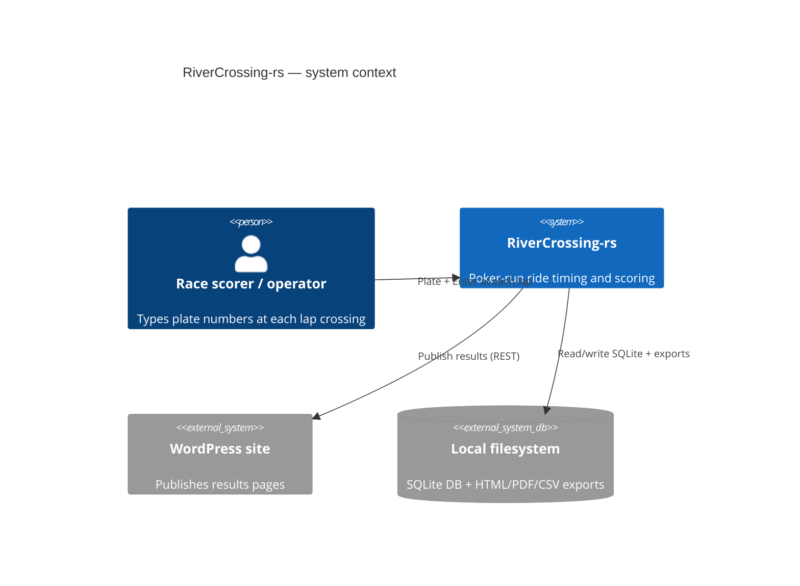
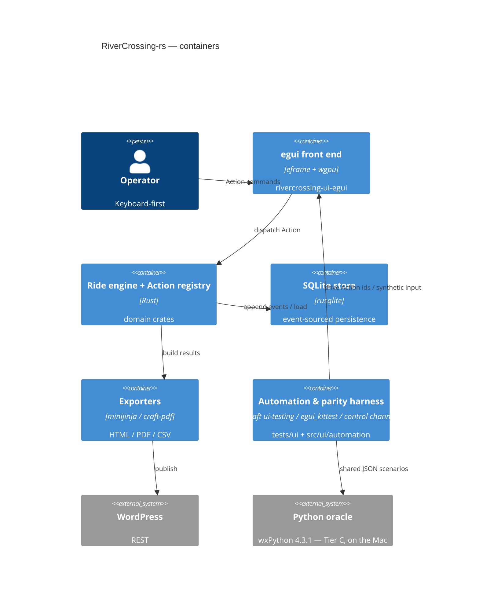
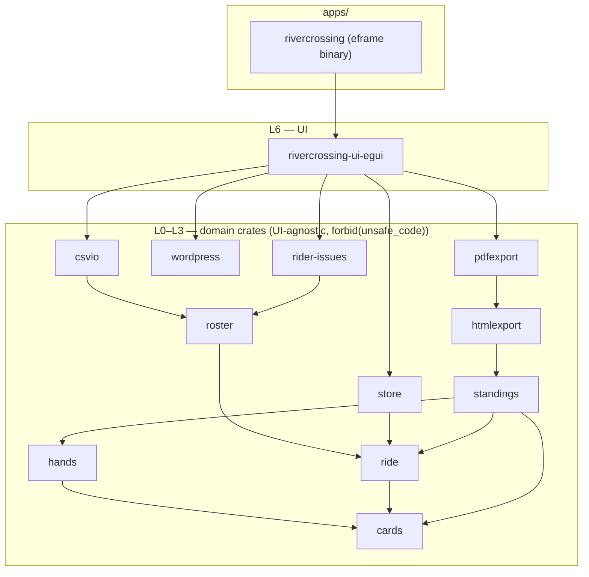
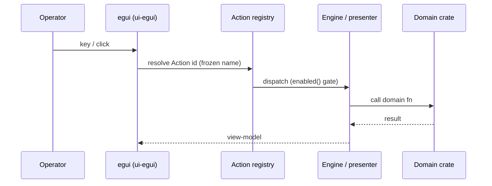
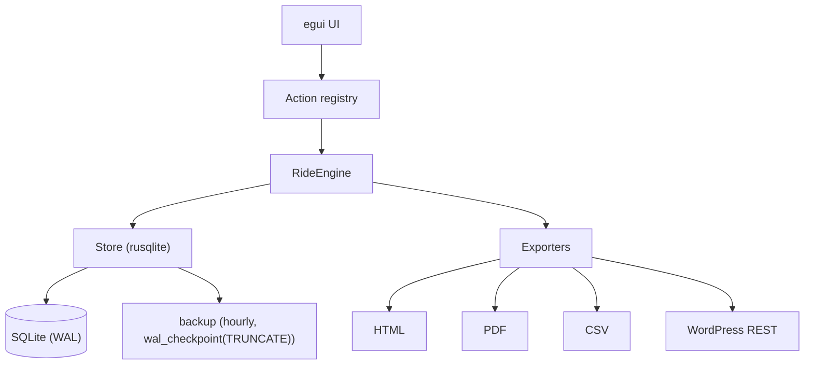

# RiverCrossing-rs — Architecture & Design

This is the Rust architecture for the RiverCrossing port. It supersedes the Python wx/XRC/MVP
architecture and is the prerequisite for `project-plan.md` and the EPIC prompts. The Rust app
reproduces the Python app's screens and functionality, built the ArtCraft way: **native egui on the
GPU**, layered Cargo crates, and a command/Action registry in place of XRC frozen names.

## 1. Overview

| Concern | Choice |
|---|---|
| UI | `egui` + `eframe` + `wgpu` (storytold forks) |
| Shared crates | `storytold/craft-libs` — `craft` facade + `craft-ui/settings/quit/menu/dialogs/i18n/keymap/atomic/update/print/pdf` |
| Windowing | `winit` (storytold fork) |
| Persistence | SQLite via `rusqlite` (bundled) |
| Templates | `minijinja` (HTML), `craft-pdf`/`krilla` (PDF) |
| Errors | `thiserror` (lib) + `anyhow` (bin) |
| Sound | `rodio` |
| Automation & testing | `craft` `ui-testing` `Fixture` + `egui_kittest` 0.37 snapshots + the `craft` `automation` control channel (§12) |
| License | GPL-3.0-only, single SPDX line per file |
| Platforms | macOS **ARM64 only** (Apple Silicon; no Intel/x86_64 build) → Windows x64+arm64 → Linux x86_64 (`.deb` + `.rpm`) |

## 2. System context (C4)

## 3. Containers (C4)

## 4. Layered crate architecture

The workspace is layered like WordCraft: domain crates are UI-agnostic, and only
`rivercrossing-ui-egui` may depend on egui/eframe/winit.

**Layering rule** (`cargo xtask layers`): nothing below `rivercrossing-ui-egui` may depend on
`egui`/`eframe`/`winit`/`rfd`. This makes the front end swappable and the domain testable headless.

**Automation adds no crate.** The EPIC-10 harness is dev-dependencies of `rivercrossing-ui-egui`
(`craft` `ui-testing`, `egui_kittest` 0.37) plus two seams: `crates/rivercrossing-ui-egui/src/ui/automation/`
(production channel glue, method table and file authority) and
`crates/rivercrossing-ui-egui/tests/ui/` (the test-only scenario model, snapshot suite and scenario
runner). `cargo xtask layers` treats `egui_kittest` as forbidden below the UI crate, alongside
`egui`/`eframe`/`winit`/`rfd`. The dependency order above is unchanged.

**Dependency order (leaf-first):** `cards` → `hands` → `ride` → `roster` → `standings` →
`rider-issues` → `store` → `csvio` → `htmlexport` → `pdfexport` → `wordpress` → `ui-egui`.

The Python `ride`↔`roster` cycle is broken by a **new `trait RosterView`** (declared in
`rivercrossing-ride`, implemented by `rivercrossing-roster`). No such trait exists in the Python
code — it is the Rust resolution of a runtime-import + `TYPE_CHECKING`-only cycle.

## 5. Command / Action registry

The Python §15 menu map + §15b frozen-name registry become a single `Action` registry — the
replacement for XRC `name` attributes and the generated `ui/ids.py`.

Every `Action` carries: a stable string id (the frozen snake_case name), a human label, a shortcut
(`Modifiers::COMMAND` abstraction), an `enabled()` predicate, and a target (open window / open dialog
/ fire command). Menu rows and on-screen buttons dispatch the **same** id; an ids-drift check fails
CI when a name appears more than once per window or is unreferenced. The Keyboard Shortcuts dialog is
generated by iterating the registry.

**The Action id is the automation selector.** Tests, scenarios and the live control channel address
a command by the same frozen id the menu and button use (§12), so a screen is drivable headlessly
with no parallel test-only naming.

## 6. UI skeleton (from the Python screens)

The Rust UI reproduces the Python app's screens and behaviour, derived from `design/mockups/` and
`ui-contract.md`, the `xrc-windows.md` behaviour oracle, and the §15 menu map. The wx
"sizer + frozen name + accelerator table" triple maps to "immediate-mode layout + frozen `egui::Id`
+ `KeyboardShortcut`". The product UX contract (keyboard-first, dialog/destructive/menu/DPI/a11y) is
unchanged — see `CODINGSTANDARDS-UX-DESKTOP.md`.

Frozen ids are also the selector contract: an `egui::Id`, a §15b name and an Action id are the same
stable handle for the life of the app. Renaming one is a breaking change for the tests, the control
channel and any recorded scenario, exactly as an XRC name rename is for the Python app (§15b).
Every input widget additionally carries an AccessKit accessible name (R-89).

## 7. Persistence & data flow

- **SQLite via `rusqlite` (bundled)** — WAL, foreign keys, `CHECK` constraints, a partial unique index
  (`entry_plate_live_unique WHERE retired=0`), full-table-rebuild migrations (SQLite cannot drop
  table-level UNIQUE), `uuid`, JSON audit payloads, `wal_checkpoint(TRUNCATE)` before backup.
- Every crossing commits as it happens; elapsed time comes from the wall clock; a crash costs at most
  the keystroke in flight.

## 8. Exports

- **HTML**: Jinja2 → `minijinja`, vendored Tailwind CSS + woff2 fonts; the committed production
  goldens (`fixtures/epic-2026-results*.html`) and their `race-data` JSON are the byte oracle.
- **PDF**: fpdf2 → `craft-pdf` (krilla), embedded Barlow / Barlow Condensed / DejaVu TTFs (licence
  notices redistributed).
- **CSV** via `rivercrossing-csvio`; **WordPress** via a single-site REST client.

## 9. Error handling, concurrency, platform

- `thiserror` enums per crate boundary; `anyhow` at the binary; `?` propagation; no
  `unwrap`/`expect`/`panic` in production; `#![forbid(unsafe_code)]` per domain crate.
- `tokio` only where async is genuinely required (WordPress publish, backup); the UI event loop is
  eframe's, not tokio's.
- Platform folders + settings via `craft-settings`; native dialogs via `craft-dialogs`; macOS app menu
  via `craft-quit` (`menu` feature) + `craft-menu`.

## 10. Build, CI, installer

- Gate: `scripts/validate-rust.sh` — fmt · clippy (`-D warnings`, plus a release `cargo check` of
  the app) · doc · nextest category/layout · MSRV + feature powerset (`cargo hack`) · deny + machete
  · `cargo xtask layers` · `ui` (snapshot + scenario, `cargo nextest -P ui`) · unit + llvm-cov 90/90
  line **and** branch. The `ui` stage and the release check are EPIC-10 (§12).
- Installers (§ in `docs/porting-python-to-rust.md`): macOS ARM64 DMG (`hdiutil`), Windows x64+arm64
  MSI (WiX v5) + portable zip, Linux x86_64 `.deb` + `.rpm` (`nfpm`), `SHA256SUMS.txt`.
- Installer build order: macOS ARM64 → Windows x64+arm64 → Linux x86_64.

## 11. Future surface — CLI + MCP

The agent-driving mechanism already exists: EPIC-10 ships the live control channel that drives the
`Action` registry over JSON (§12). What remains here is the standing surface — a CLI
(`apps/rivercrossing-cli`) and an MCP server (mirroring ArtCraft's "every button is a command"
surface), so agents reach every command the GUI can without the debug-only channel.

- **MCP**: the shared **`craft-mcp-server`** crate (craft-libs) — JSON-RPC 2.0 over stdio, the MCP
  lifecycle, tools/resources/prompts, tool schemas and argument checks, text/image results. The app
  implements `Tools`; `Server` speaks the protocol. No third-party MCP SDK.
- **CLI**: hand-rolled subcommand parsing (no `clap`), dispatching to the `Action` registry with
  `serde_json` params — the `wordcraft-cli` pattern.
- **Release control surface**: the consented `AgentSettings` path that turns on a stable-build
  control channel; EPIC-10's channel is debug-only (§12).

## 12. UI automation & Python-parity harness

EPIC-10 delivers the test contract before EPIC-12 builds the screens. There is **no new crate, no
new binary and no cargo feature**: the harness is dev-dependencies of `rivercrossing-ui-egui` plus
the two seams in §4, and the live channel rides the existing app binary.

| Surface | Where | What it is |
|---|---|---|
| Semantic harness | `craft::ui::testing::{Fixture, Frames}` (`craft` feature `ui-testing`), used in `src/ui/**/tests.rs` | drives the app in-process over `Rc<RefCell<RiverCrossingApp>>`; no display, no GPU |
| Snapshot suite | `egui_kittest` 0.37 (`snapshot` + `wgpu`), `tests/ui/main.rs` (`[[test]] name = "ui"`, `cargo nextest -P ui`) | offscreen PNG goldens of the shell, then of every screen state |
| Scenario / observation model | `src/ui/automation/scenario.rs` — automation API, not a test-only file | versioned JSON: `Scenario`/`Step`/`Observation`/`WireTree`/`Node`; `Observation.tree` mirrors craft's flat `accessTree` reply |
| Live control channel | `crates/rivercrossing-ui-egui/src/ui/automation/` + `apps/rivercrossing` | `craft` `automation`: `ControlChannel` in the logic pass, the app-owned method table (selector resolution), `Captures` |
| Parity contract | `tools/parity/schema.json` + the Python in-process driver | one schema, both languages; no shared Rust types |

**Selector.** Action id first, `RoleAndLabel { role, label, window }` second; no `NodeId`; a bare
label is a test-side convenience only; bounds/point selection is the last resort for a command-less
canvas target. A repeated label is scoped by its window, and multiple matches without one are an
error (R-87).

**Tiers.** A — semantic, `-P unit`, no display/GPU · A-snapshot — `egui_kittest`, `-P ui`, Linux +
lavapipe · B — two real-window smokes (open/quit and the control channel), `xvfb-run` on the forge
box · C — Python parity through shared scenarios, in-process pytest on the Mac at EPIC-12 exit.

**Snapshots.** One golden host (Linux + lavapipe); `[linux] 0.6`, `[mac] 2.0` in `kittest.toml`;
goldens in `crates/rivercrossing-ui-egui/tests/snapshots`; app fonts installed so a missing glyph
fails; no skips (R-90).

**Live channel.** Debug builds only — the whole acquisition, flags and environment, sits behind one
`#[cfg(debug_assertions)]` function and runs `resolve` → `check` → `server_token`. Loopback bind,
a caller-supplied token file is read (a generated token is printed to stderr), the canonicalised
`<cwd>/target/control` write root rejects `..`/symlink escapes, `REPLY_DEADLINE` 60 s, and the
`Listening` guard is dropped on quit. `ctx.enable_accesskit()` is called once in `run`'s `make`
(R-88). The three `ui.dialog.*` methods return a typed "no hosted dialog" until EPIC-12.

**Parity.** `Scenario`/`Step`/`Observation`/`WireTree`/`Node` JSON v1 in `tools/parity/schema.json`,
structurally checked against the serde derive by unit test; `Observation.tree` mirrors craft's flat
`accessTree` reply. Tier C compares structured trees exactly and PNGs within threshold, writing
artifacts under `target/gate/parity/` (R-91).

**Scope split.** R-87, R-90 and R-91 are partially satisfied here and completed in EPIC-12; R-88's
dialog clause is also partial; R-89 and R-92 are satisfied here. EPIC-10 exercises the shell and a
debug probe surface only and ships no partial frozen-id manifest; EPIC-12 inherits the per-screen
tests, goldens, real `ui.inspect`/`ui.set` fields and the parity report. Details:
[automation](automation.md) and [test plan](test-plan.md).

Companions: [automation](automation.md) · [test plan](test-plan.md) · [requirements](requirements.md)
· [engineering spec](spec.md) · [project plan](project-plan.md) · [task briefs](task-briefs.md).
