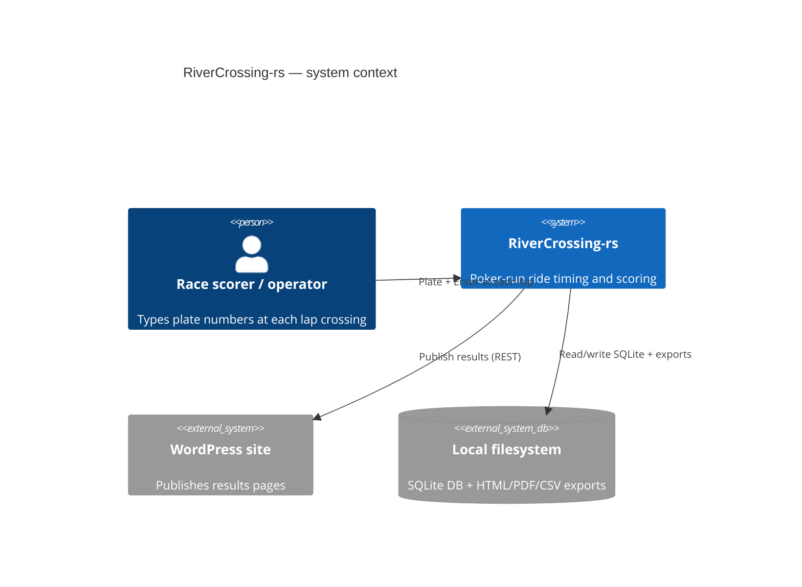
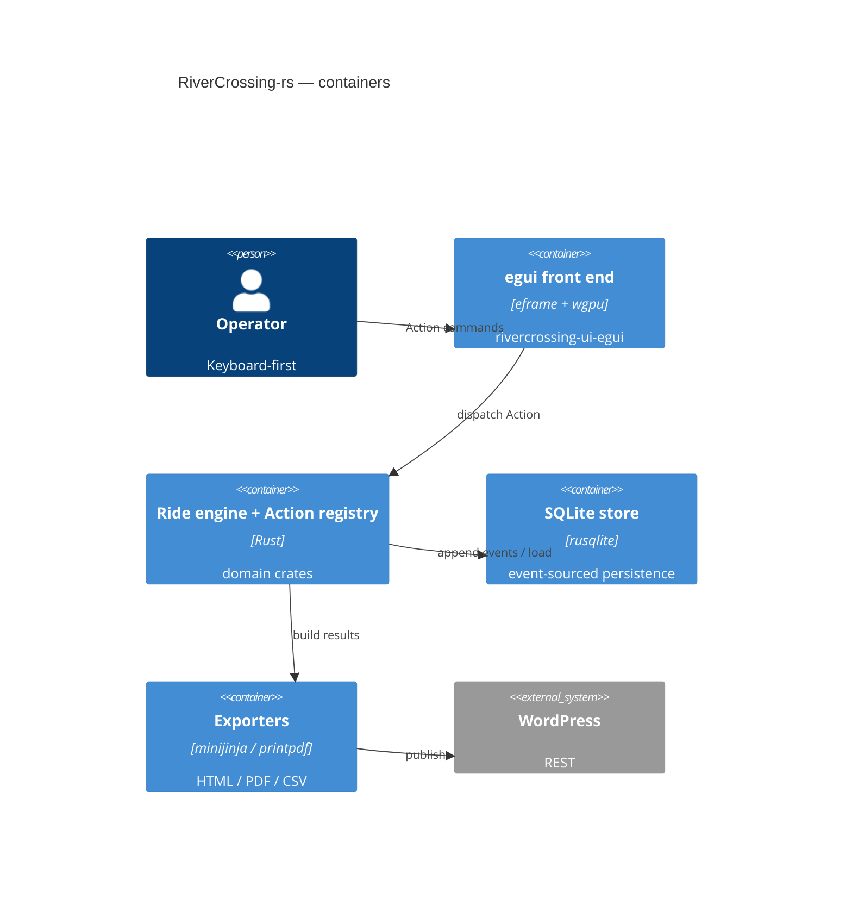
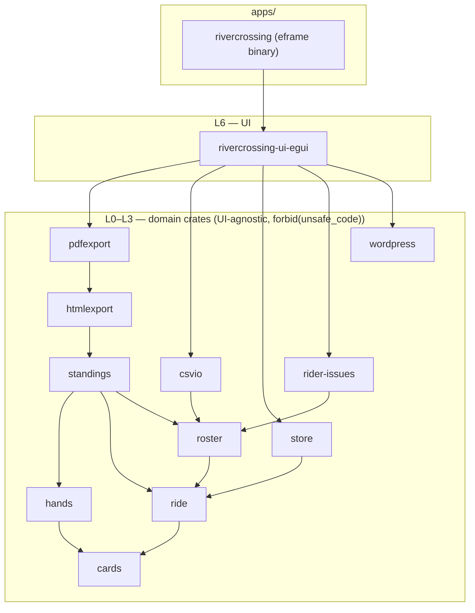
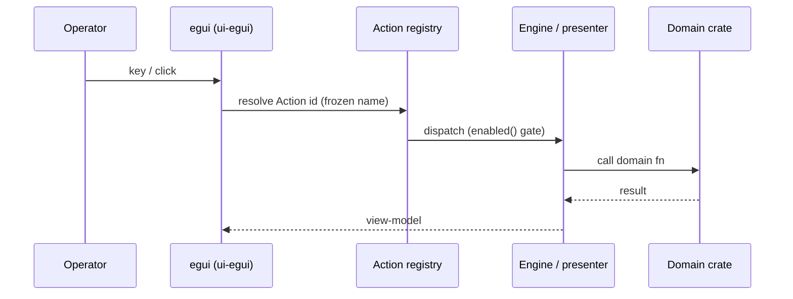
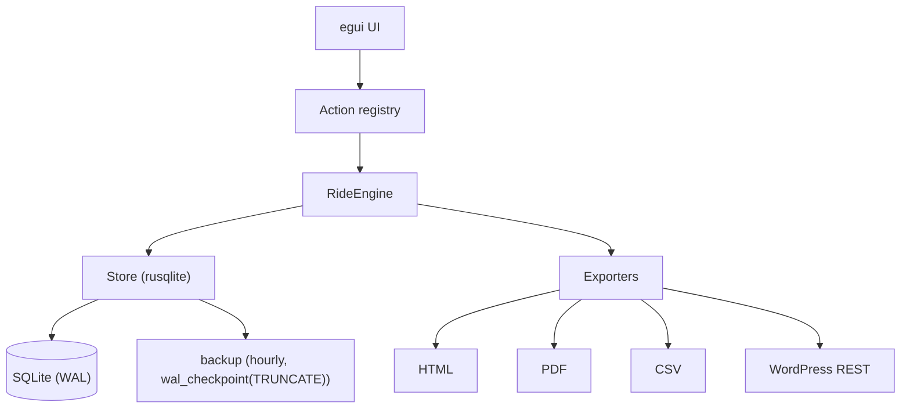

# RiverCrossing-rs — Architecture & Design

This is the Rust architecture for the RiverCrossing port. It supersedes the Python wx/XRC/MVP
architecture and is the prerequisite for `project-plan.md` and the EPIC prompts. The Rust app
reproduces the Python app's screens and functionality, built the ArtCraft way: **native egui on the
GPU**, layered Cargo crates, and a command/Action registry in place of XRC frozen names.

## 1. Overview

| Concern | Choice |
|---|---|
| UI | `egui` + `eframe` + `wgpu` (storytold forks) |
| Shared crates | `storytold/craft-libs` — `craft` facade + `craft-ui/settings/quit/menu/dialogs/i18n/keymap/atomic/update/print/pdf` |
| Windowing | `winit` (storytold fork) |
| Persistence | SQLite via `rusqlite` (bundled) |
| Templates | `minijinja`/`askama` (HTML), `printpdf`/`lopdf` (PDF) |
| Errors | `thiserror` (lib) + `anyhow` (bin) |
| Sound | `rodio` |
| License | GPL-3.0-only, single SPDX line per file |
| Platforms | macOS (ARM64) → Windows x64+arm64 → Linux x86_64 (`.deb` + `.rpm`) |

## 2. System context (C4)

## 3. Containers (C4)

## 4. Layered crate architecture

The workspace is layered like WordCraft: domain crates are UI-agnostic, and only
`rivercrossing-ui-egui` may depend on egui/eframe/winit.

**Layering rule** (`cargo xtask layers`): nothing below `rivercrossing-ui-egui` may depend on
`egui`/`eframe`/`winit`/`rfd`. This makes the front end swappable and the domain testable headless.

**Dependency order (leaf-first):** `cards` → `hands` → `standings` → `ride` → `roster` →
`rider-issues` → `store` → `csvio` → `htmlexport` → `pdfexport` → `wordpress` → `ui-egui`.

The Python `ride`↔`roster` cycle is broken by a **new `trait RosterView`** (declared in
`rivercrossing-ride`, implemented by `rivercrossing-roster`). No such trait exists in the Python
code — it is the Rust resolution of a runtime-import + `TYPE_CHECKING`-only cycle.

## 5. Command / Action registry

The Python §15 menu map + §15b frozen-name registry become a single `Action` registry — the
replacement for XRC `name` attributes and the generated `ui/ids.py`.

Every `Action` carries: a stable string id (the frozen snake_case name), a human label, a shortcut
(`Modifiers::COMMAND` abstraction), an `enabled()` predicate, and a target (open window / open dialog
/ fire command). Menu rows and on-screen buttons dispatch the **same** id; an ids-drift check fails
CI when a name appears more than once per window or is unreferenced. The Keyboard Shortcuts dialog is
generated by iterating the registry.

## 6. UI skeleton (from the Python screens)

The Rust UI reproduces the Python app's screens, derived from `design/screenshots/`, the
`gui-windows.md` window inventory (settling the 23-vs-27 count), and the §15 menu map. The wx
"sizer + frozen name + accelerator table" triple maps to "immediate-mode layout + frozen `egui::Id`
+ `KeyboardShortcut`". The product UX contract (keyboard-first, dialog/destructive/menu/DPI/a11y) is
unchanged — see `CODINGSTANDARDS-UX-DESKTOP.md`.

## 7. Persistence & data flow

- **SQLite via `rusqlite` (bundled)** — WAL, foreign keys, `CHECK` constraints, a partial unique index
  (`entry_plate_live_unique WHERE retired=0`), full-table-rebuild migrations (SQLite cannot drop
  table-level UNIQUE), `uuid`, JSON audit payloads, `wal_checkpoint(TRUNCATE)` before backup.
- Every crossing commits as it happens; elapsed time comes from the wall clock; a crash costs at most
  the keystroke in flight.

## 8. Exports

- **HTML**: Jinja2 → `minijinja`/`askama`, vendored Tailwind CSS + woff2 fonts; the golden
  `design/exports/*.html` `race-data` JSON is the byte oracle.
- **PDF**: fpdf2 → `printpdf`/`lopdf` (or `craft-pdf`), embedded Barlow / Barlow Condensed / DejaVu
  TTFs (OFL notices redistributed).
- **CSV** via `rivercrossing-csvio`; **WordPress** via a single-site REST client.

## 9. Error handling, concurrency, platform

- `thiserror` enums per crate boundary; `anyhow` at the binary; `?` propagation; no
  `unwrap`/`expect`/`panic` in production; `#![forbid(unsafe_code)]` per domain crate.
- `tokio` only where async is genuinely required (WordPress publish, backup); the UI event loop is
  eframe's, not tokio's.
- Platform folders + settings via `craft-settings`; native dialogs via `craft-dialogs`; macOS app menu
  via `craft-quit` (`menu` feature) + `craft-menu`.

## 10. Build, CI, installer

- Gate: `scripts/validate-rust.sh` (fmt, clippy deny, doc, deny, machete, hack, nextest, llvm-cov
  90/90).
- Installers (§ in `docs/porting-python-to-rust.md`): macOS ARM64 DMG (`hdiutil`), Windows x64+arm64
  MSI (WiX v5) + portable zip, Linux x86_64 `.deb` + `.rpm` (`nfpm`), `SHA256SUMS.txt`.
- CI order: macOS ARM64 → Windows x64+arm64 → Linux x86_64.

## 11. Future surface — CLI + MCP

After 100% Python parity, expose the `Action` registry via a CLI (`apps/rivercrossing-cli`), a JSON
control channel, and an MCP server (mirroring ArtCraft's "every button is a command" surface), so
agents drive every command the GUI can.
